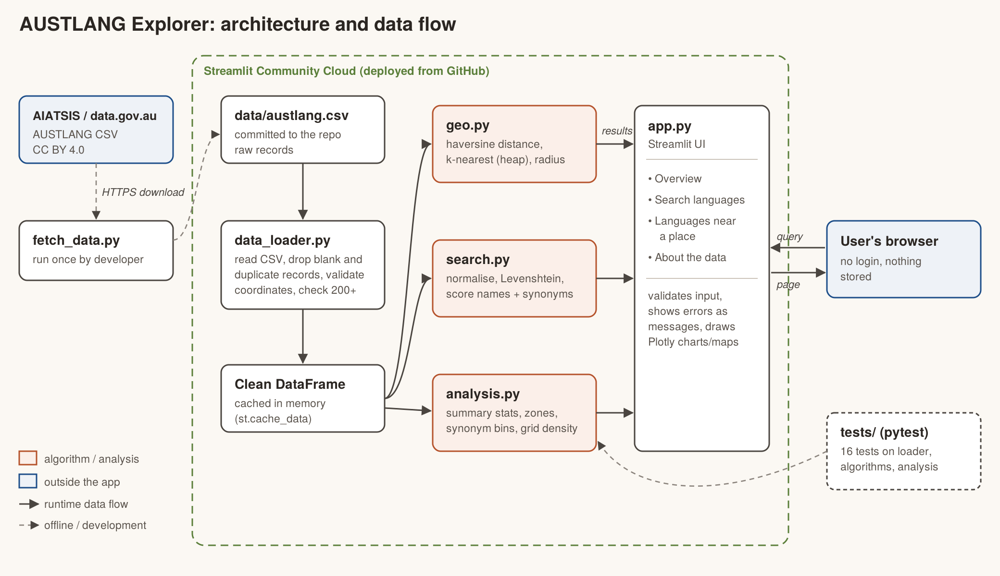

# Architecture

## Components

| Component | Responsibility |
|---|---|
| `scripts/fetch_data.py` | Downloads the AUSTLANG CSV from AIATSIS once, during development, and reports record counts. |
| `data/austlang.csv` | The raw dataset, committed so the deployed app does not depend on an external API. |
| `src/data_loader.py` | Reads the CSV, cleans it (blank/duplicate records, invalid coordinates, synonym lists) and checks there are at least 200 records. |
| `src/geo.py` | Haversine distance; finds the k nearest language points to a location using a heap; counts points within a radius. |
| `src/search.py` | Normalises text and scores names and alternative spellings with a hand-written Levenshtein edit distance. |
| `src/analysis.py` | Summary statistics, north/south zones, alternative-name distribution and grid-cell density. |
| `app.py` | Streamlit interface: sidebar navigation, four views, input validation, charts and maps. |
| `tests/` | 16 pytest tests against a fixture file of placeholder records. |

## Data flow

1. At start-up `app.py` calls `load_dataset()`, which reads and cleans the CSV. `st.cache_data` keeps the cleaned DataFrame in memory, so this happens once.
2. When the user interacts (types a search, picks a place, moves a slider), Streamlit reruns `app.py` with the new input.
3. `app.py` passes the cached DataFrame and the input to `search.py`, `geo.py` or `analysis.py`. Those modules validate the input and raise `ValueError` if it is unusable.
4. Results return to `app.py` as lists of dicts or DataFrames and are shown as tables, metrics, Plotly charts and maps. Errors are shown as messages.
5. Nothing the user enters is stored or sent anywhere else.
